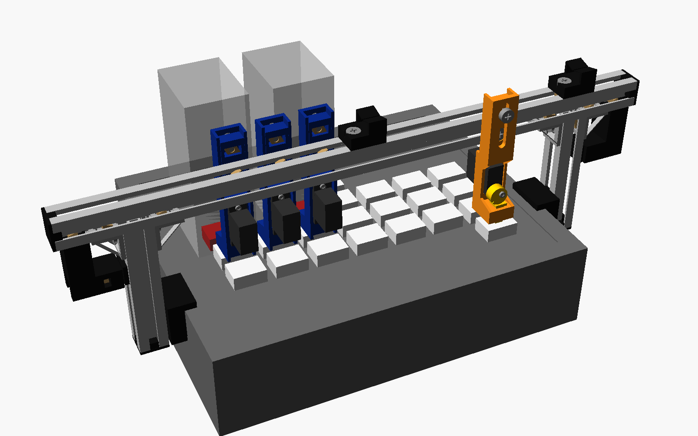
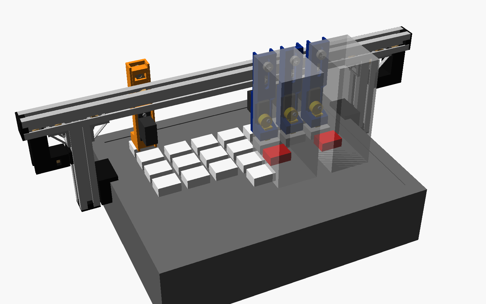
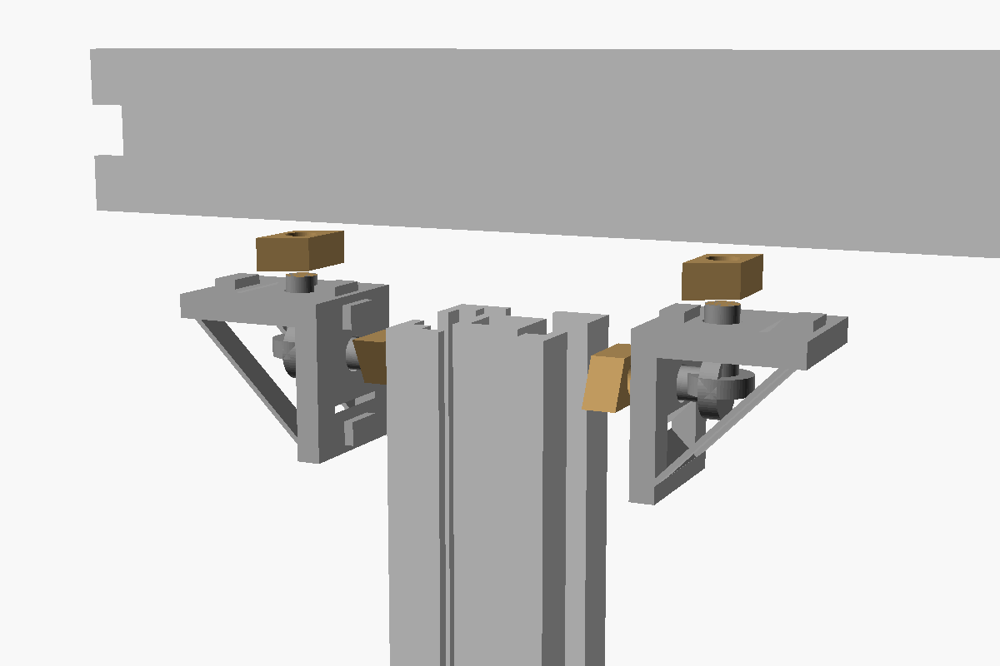
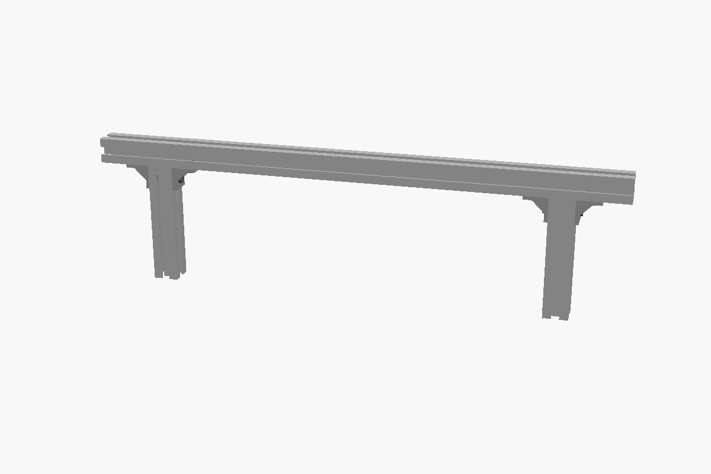
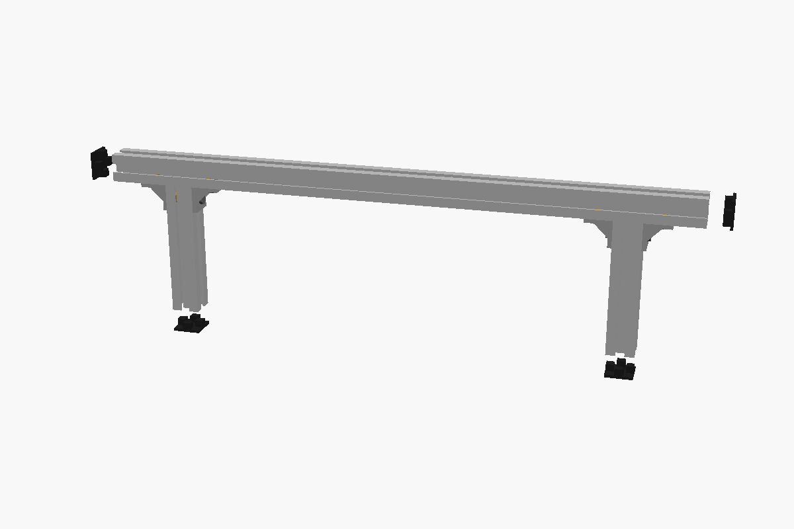
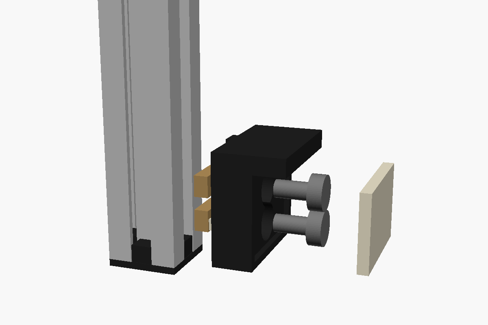
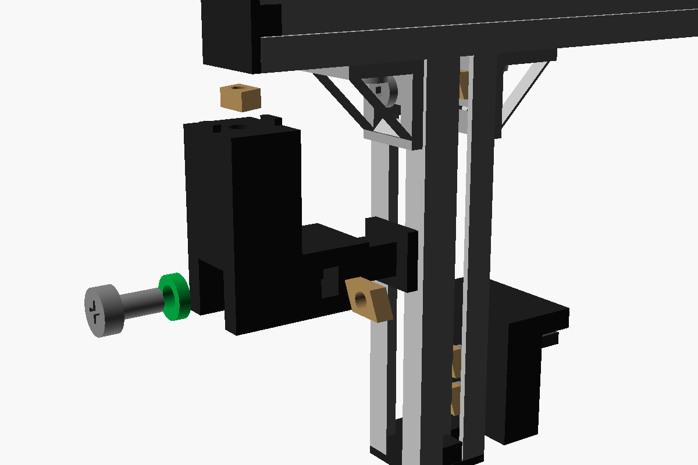
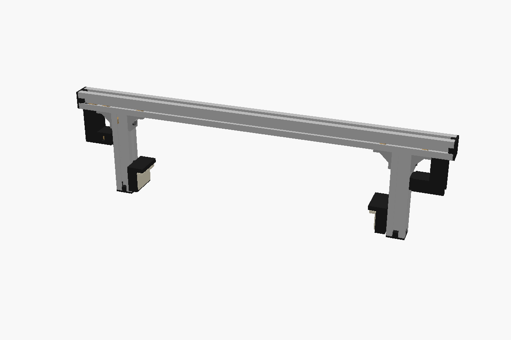
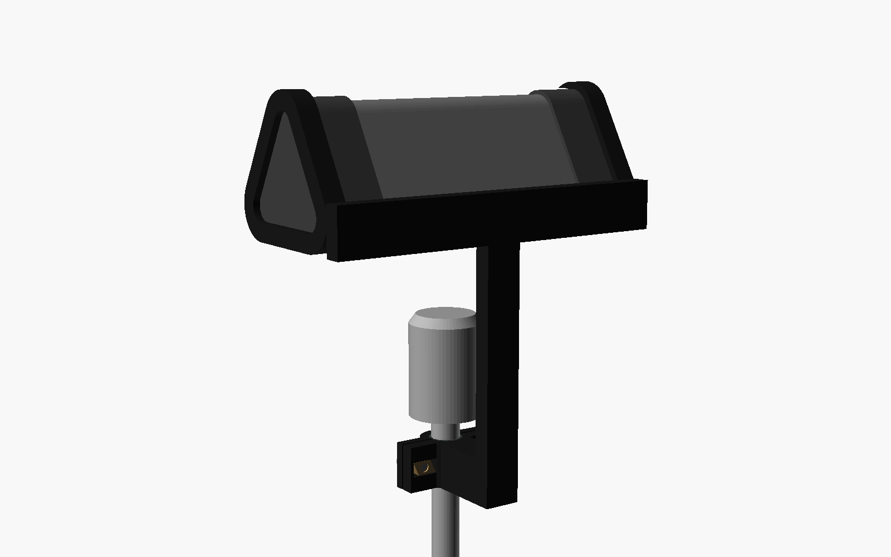
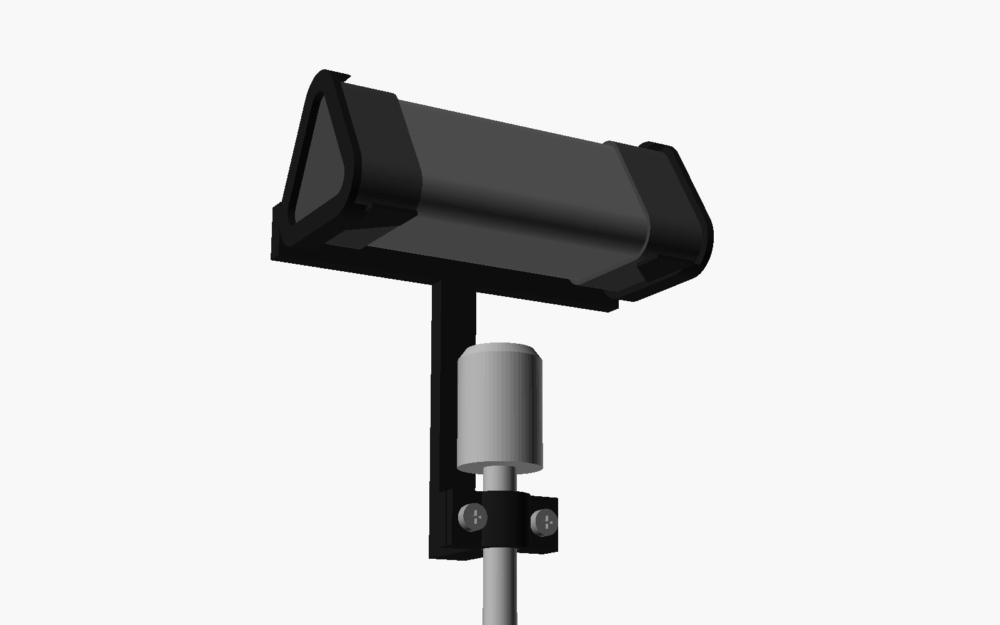

# Servo rig parts

Parametric OpenSCAD sources for the rig that presses buttons on the IMPRO desk from the outside. The numbers come from one file, `params.scad`. The desk and the bought parts are measured (`// MEASURED` with the date). What is left is marked `// ESTIMATE` with what to measure. Change them there, re-render, reprint.

Render a part with `openscad -o part.stl part.scad`. STLs are not committed. Each part file lays its part in print orientation.

## Parts

| File | Part | Print | Colour |
|---|---|---|---|
| `edge_clamp.scad` | Padded clamp jaw, for both case sides (the same part turned 180 degrees) | 2 | Black |
| `servo_carriage.scad` | Module carriage: bolts to a rail face, keyed in the slot | 4 | Blue x3, Pumpkin Orange x1 (SPREKEN) |
| `servo_bracket.scad` | Module bracket: holds the servo and plunger guide, slides up and down the carriage | 4 | Blue x3, Pumpkin Orange x1 (SPREKEN) |
| `servo_cam.scad` | Cam on the servo horn | 4 | Sunflower Yellow |
| `servo_plunger.scad` | Plunger between cam and button | 4 + spare | Sunflower Yellow |
| `tensioner_block.scad` | Tensioner block on the rail outside each post, for both sides (the same part turned 180 degrees) | 2 | Black |
| `tensioner_pad.scad` | Tensioner pressure pad, bridges the slot in the post | 2 | Black |
| `tensioner_collar.scad` | Stop collars under the push bolt head, set the squeeze. One plate: 2 each of 2.2, 2.4, 2.6 and 2.8 mm | 1 plate | Bambu Green |
| `squeeze_gauge.scad` | Go/no-go feeler gauge for the post gap, one for both sides | 1 | Hot Pink |
| `end_cap.scad` | Press-fit end cap: 2 rail ends, 2 post bottoms | 4 + spare | Black |
| `speaker_cradle.scad` | ER-151 cradle, arm and fixed half of the tube clamp | 1 | Black |
| `speaker_clamp_cap.scad` | Removable half of the tube clamp | 1 | Black |
| `speaker_snap_test.scad` | Cradle fit test: three cradle ends with different clearances. Print before the cradle | 1 plate | Black |
| `../replica/replica_panel.scad` | Replica of the desk top | 1 | Gray |
| `../replica/test_button_plunger.scad` | Test button cap and snap stem | 4 | Jade White |
| `../replica/test_button_leaf.scad` | Test button leaf spring | 4 + spare | Jade White |
| `../replica/alarm_cover.scad` | Dummy flip cover | 2 | Red |
| `rig.3mf` | Bambu Studio project with every printed part on 9 plates, colours and settings set, ready to print | 9 plates | as above |
| `frame_assembly.scad` | The whole rig. Not printed: a picture and the safety checks | - | - |
| `hardware.scad` | Bought parts and EVA pads for the pictures: bolts, drop-in nuts, corner brackets, servo and horn screws, clamp pads, plunger dots. Not printed | - | - |
| `speaker_assembly.scad` | The speaker in its cradle on the mic's gooseneck, with the clamp cap, lining, bolts and nuts. Not printed: a picture, separate from the rig | - | - |
| `assembly_steps.scad` | Assembly step pictures in `img/`. Not printed. Re-render with `render_assembly_steps.sh` | - | - |
| `params.scad`, `lib.scad` | All dimensions; shared geometry | - | - |

**Colours when slicing.** The colours are Bambu Lab PLA Basic. Each file is one colour, so slice one plate per colour. For the carriage and the bracket that means two plates each: 3 in Blue and 1 in Pumpkin Orange. Never print a rig part in Red: on the desk, red means the covered alarm buttons, and the only red print is the replica's dummy cover.

| Colour | Parts |
|---|---|
| Black (10101) | 2 jaws, 2 tensioner blocks, 2 tensioner pads, end caps, speaker cradle and clamp cap, fit test plate |
| Blue (10601) | 3 carriages and 3 brackets, for SC 1, SC 2 and SC 3 |
| Pumpkin Orange (10301) | 1 carriage and 1 bracket, for SPREKEN |
| Sunflower Yellow (10402) | 4 cams, 4 plungers and a spare: the moving parts |
| Bambu Green (10501) | Stop collar plate |
| Hot Pink (10204) | Squeeze gauge |
| Gray (10103) | Replica panel |
| Jade White (10100) | Replica test button caps and leaf springs |
| Red (10200) | Replica dummy covers only |

`frame_assembly.scad` draws the rig in these colours. `render_colours.sh` renders these pictures and the speaker ones below; keep its camera settings, so new renders match:

The grey translucent blocks are the keep-out volumes over the covered buttons, not parts. The model also draws the bought parts from `hardware.scad`: every bolt and drop-in nut (in tan, so they stand out), the corner brackets, the EVA pads and plunger dots, and the servo and horn screws. The tensioners are drawn clamped, with the push bolt seated on its collar. The corner bracket's width, bolt hole position, lips and window are estimates (`corner_*` in `params.scad`): they only change the pictures.

## Print settings (Bambu Lab H2D)

| Setting | Structural parts (clamps, carriages, brackets, tensioner blocks and pads) | Other parts |
|---|---|---|
| Material | PLA Basic | PLA Basic |
| Layer height | 0.2 mm | 0.2 mm |
| Walls | 5 | 3 |
| Top and bottom layers | 6 | 4 |
| Infill | 40 % gyroid | 15 % |
| Supports | None. See the tensioner block note | Only for `speaker_cradle.scad`, under the cups |

Print the tensioner block standing on its outer end, as its file lays it out. Slicing it shows three short bridges and no other overhang: the shoulder over the head slot (10.7 mm), the ceiling of the T-nut pocket (6.4 mm), and the top of the horizontal rail bolt hole (about 6 mm). The shoulder carries the push load, and it bends along its bridge strands, which is the strong direction. It has a 0.2 mm skin closing the bolt hole so the bridge prints whole: drill it out with a 5.5 mm drill (`m5_clear`). Check the collar thicknesses with calipers. The nominal collar is 2.6 mm and has no notch. Each notch on the rim means 0.2 mm thinner (2.4 and 2.2 mm), and a flat on the rim marks the 2.8 mm one.

Print the gauge as laid out, so the blade thickness is in the print plane. Check both blades with calipers: go 11.45 mm, no-go 12.05 mm. If one is more than 0.1 mm off, sand it or reprint.

Print the replica open side down. The plate bridges between the ribs. A 0.2 mm skin closes the four plunger holes at the plate's underside, so the bridge prints whole: cut it out with a hobby knife from below, along the hole's edges. The leaf springs need 100 % infill and must lie flat, so the leaf thickness is a whole number of layers. Print the plungers and the cam with 5 walls: they carry the press force.

Print the bracket upright, with the plunger guide end on the bed, as its file lays it out. It is 95 mm tall and needs no supports: a 45 degree gusset carries the shelf, and the shelf and the top of the servo window are bridges of 16 and 13 mm between the side walls. Print the plunger upright too, with its collar on the bed. Print the carriage flat on its front face, the one the bracket slides on: the bolt holes are then vertical and the nut pocket and slot key face up. The ceiling of the head recess is a 10.5 mm bridge with a 0.2 mm skin closing the bolt hole, like on the tensioner block: drill it out with a 5.5 mm drill.

## Cutting the extrusion

From the 1 m 2020 profile, with the desk as measured on 2026-11-12 and the parts as measured on 2026-11-17:

- 1 rail, `rail_len` = **425.6 mm**
- 2 posts, `post_len` = **97.4 mm** each

That leaves about 374 mm spare. These lengths follow `params.scad`: if a dimension changes, run `openscad -o /tmp/a.stl frame_assembly.scad` and read them from the `ECHO` lines.

## Assembly

**All the nuts are drop-in.** The M5 nuts (about 10 x 6 mm) and the M4 nuts of the corner brackets (11.4 x 5.8 mm) go into a slot from the front, anywhere along it, and turn to lock as the bolt tightens. Nothing has to go in from a profile end, and a missed nut can be added later. In the printed pockets the M5 nuts lie the long way and cannot turn.

Count of M5 nuts, with the default four modules:

| Where | Slot | Nuts |
|---|---|---|
| Rail | Back face (towards the SC row) | 3, one per SC module |
| Rail | Front face (towards SPREKEN) | 1 |
| Rail | Bottom slot, outermost at each end, for the tensioner blocks | 2 |
| Each post | Inner face, for the clamp jaw | 2 per post, so 4 |
| Module carriages | Pocket for the height bolt | 4 |
| Tensioner blocks | Pocket for the push bolt | 2 |
| Speaker clamp | Pockets | 2 |
| **Total** | | **18 of the 20 ordered** |

The corner brackets bring their own hardware, which is not in this count: M4x8 bolts and M4 drop-in nuts, 2 of each per bracket, so **8 M4 nuts on top of the 18 M5**. One nut of each bracket goes in the rail's bottom slot and the other in a post's side slot.

Use M5x10 for every printed part, including the tensioner. M5x8 leaves too little thread in the T-nut there. The M5 bolts are pan head with a Phillips drive (head 9.9 x 4.0 mm, real length 9.8 mm), so every M5 needs a PH2 screwdriver in line with the bolt. The bracket bolts are M4 with a 2.5 mm hex key.

Cut these pads from the sheet, slightly oversize so they press in:

| Pad | Size | Quantity |
|---|---|---|
| Jaw side | 30 x 22 mm | 2 |
| Under the lip | 30 x 7 mm | 2 |
| Plunger tip dot | 5 x 5 mm, press fit in the 4.5 mm recess, stands 1 mm proud | 4 |

The side pads and tip dots stay in by the press fit. The under-lip pad hangs upside down while the frame is lowered: a dab of removable tack on the pad-to-jaw side only is fine. Never put anything on the side that faces the desk.

1. Cut the rail and posts. Put each nut in its slot as you reach the part that needs it.
2. Join each post's top end to the rail's bottom face with 2 corner brackets, one on each side of the post, with the M4x8 bolts. Tighten the bolts into the post. Leave the bolts into the rail loose, so the posts slide along the rail. The bracket's centring lips sit in the slot, so a loose bracket still slides along the rail.

   

   

3. Press the end caps into the rail ends and post bottoms.

   

4. Bolt a jaw to each post's inner face with 2 M5x10, key in the slot, lip at the top pointing to the desk, then push in the pads. Its bottom edge sits `post_tail` (5 mm) above the end of the profile; if the post came out longer than `post_len`, add the difference, so the rail stays at its height. No adhesive. The pad covers the bolt heads, so take it out to adjust the jaw.

   

5. Tensioner, one per side: drill out the skin in the shoulder hole. Slide a T-nut into the block's pocket. Put a nominal stop collar (2.6 mm, no notch) on an M5x10 under its head, and thread the bolt through the shoulder into the nut. Put the pad's stub in the socket. Bolt the block to the rail's bottom slot with an M5x10, key in the slot, with the screwdriver up through the head slot. Keep it loose for now.

   

   

6. Set the squeeze, without the modules. See "Setting the squeeze".
7. Module: trim a stock single horn to `horn_stub` (7.5 mm from the axis). Drop the plunger into the guide from above, with the dot in its tip, **before** the servo: once the servo is in, the plunger no longer fits past it. Fit the servo from the back with the ears on the back face and the servo's own screws. Fit the horn and the cam with an M2.5x10 screw, its head on the cam's front face. The stock screw is too short with a cam (tested 2026-11-17). A screw goes about 4.5 mm into the shaft before it bottoms, so the cam is 6.6 mm thick and its 4 mm floor leaves 4 mm of thread in the shaft. If the screw bottoms before the head clamps the cam, put an M2.5 washer under the head. The screw only holds the cam on: the arm in its pocket carries the turning force.
8. Carriage on rail: M5x10 into a T-nut, key in the slot. Bracket on carriage: M5x10 through the slot into a T-nut in the pocket. The slot also gives a screwdriver access to the rail bolt, so a module can slide along the rail without taking it apart.
9. Slide each module over its button. With the eccentric pointing up, which is the cam's clear position, adjust the height so that the plunger rests on the cap with about 1 mm gap to the cam. Do not set this at servo angle 90: see "Cam calibration".

Module height adjustment is +6 mm and -3 mm: further down, the guide touches the cap.

Modules reach rows 1 and 3 on any column, so the SC row and the SPREKEN row. They cannot reach row 2 (ALGEMEEN to MUZIEK ZACHTER), because the rail runs directly above it. `params.scad` fails the render if you list a button there.

## Setting the squeeze

The clamping force comes from compressing the side pads by `pad_squeeze`, **0.8 mm per side**, which is one full turn of the push bolt. The pad is hidden, so its compression cannot be measured. The stop collar sets it instead, from a defined start, and a gauge checks the result.

| Post inner face to case wall, each side | Meaning |
|---|---|
| 12.5 mm | Pad just touching: the start |
| **11.7 mm** | **Target: the collar has seated** |
| 11.0 mm | Jaw plastic touches the case. **Never go this far: it can mark the desk.** |

These follow the measured `case_w`, and `frame_assembly.scad` echoes them.

1. Lower the frame over the desk with the lips resting on the rim. The bolts into the rail stay just loose enough to slide, on all 4 corner brackets: snug each one, then back it off about a quarter turn. A looser bracket lets the post tilt, and a tight one stops it sliding. The bracket's centring lips sit in the slot: a loose bracket still slides along the rail, which steps 3 and 5 rely on.
2. Back off each push bolt by at least one full turn from the collar, and push the pad fully into its block.
3. Bring each post inward by hand until its pad just touches the case wall: the post stops sliding freely. Do not press into the foam.
4. Slide each block along the rail until its pad touches the post, without moving the post. Tighten the block's rail bolt with a PH2 screwdriver, straight up from below through the head slot. The bolt head sits about 128 mm above the table, so the screwdriver must be shorter than that, tip to end. Tim's 124 mm one fits (108 mm without its end cap).
5. Turn the push bolts in with the screwdriver, from outside, along the rail. Take turns, a quarter turn per side, until each head seats on its collar and stops. From contact that is one turn, 0.8 mm. If you backed off further, the first turns do nothing, and the result is the same. A loose post tilts, because the bolt pushes above the pad, so keep the posts upright.
6. Lock the corner bracket bolts into the rail, with the 2.5 mm hex key: they are M4x8. Reach the outer bracket's bolts with the key's short arm, from below, through the gap above the block's arm, with the long arm swinging out to the front or back. The CAD draws the bracket as a cube, so the real access may instead be from the side or through the window in the sloped face.
7. Check with the gauge at the front and back edge of each post. Hold it by the bar, flat face against the case wall, and push a blade gently up from below, between the case wall and the 5 mm of post that sticks out below the jaw. Turn it around for the other side.
   - **The GO blade must fit.** If it does not, the jaw plastic is too close: loosen the brackets and start again from step 2.
   - **The NO blade must not fit.** If it does, the pad is not compressed enough: start again from step 2.
   - **Same result a second time:** change the collar on that side, one step at a time, and start again from step 2. NO blade fits: one step thinner. GO blade does not fit: one step thicker. Each step is 0.2 mm of squeeze.

If locking moved a post, the gauge shows it. Loosen, correct and measure again. If you have calipers that reach, you can also check the spacing of the post inner faces, 303.4 mm with the measured `case_w` of 280 mm, just above the jaws and before fitting the modules. That check is optional.

The block only pushes, and the collar touches only the block and the bolt, so the screw cannot pass the limit however hard you turn it, but only with the collar fitted and as long as the start was right. Never run the push bolt without a collar: the collar is what stops the screw driving the jaw plastic into the case.

**Why a collar set.** The squeeze depends on the real bolt length (9.8 mm on the measured one; others may differ a little), on how the block printed, and on how much the block gives under load. Those errors are the same on every attempt, so repeating the procedure does not remove them: a different collar does. On paper the thinnest collar (2.2 mm) gives 1.2 mm, which still leaves 0.3 mm before the jaw plastic touches the case. A touch is not a disaster, but avoid it: the gauge's GO blade is the check.

**Bench check, before the desk.** Assemble one block with its nut, pad, bolt and nominal collar. Back the bolt off and push the pad fully in, then turn the bolt in until the head seats. Measure the gap that opens between the pad's plate and the block's end, with calipers or feeler blades: it should be 0.8 mm. If it is off by 0.2 mm or more, start with the collar that corrects it. This check is without load, so the block's give is not in it: the gauge on the desk has the last word.

**Foam take-up.** The tensioner stays fitted. If the foam relaxes, repeat the whole procedure from step 1, with the modules still on. The collar then sets the same squeeze from the pad's new contact. Keep the collar that passed the gauge: do not go thinner to make up for relaxed foam. If the GO blade no longer fits after this, the pad has taken a permanent set: replace it.

## Cam calibration

Fit the cam with the eccentric horizontal at servo angle 90 (the groove on the cam's face marks the eccentric). **Fit all modules with the eccentric on the same side**: neighbouring cams then never swing towards each other. Then calibrate with the GUI on the real button. On the replica (calibrated 2026-11-25), with every eccentric on the same side, rest came out at 45 on all four and press at 93 to 113 (SPREKEN 93, SC1 99, SC2 101, SC3 113): pressing goes up from rest. With the eccentric on the other side the numbers mirror around 90: rest near 135, and pressing goes down.

**Before the first connect with modules on the desk, set `rest` to 45 and `press` to a safe angle close to it, for example 60, in `config.toml`, and keep the plungers out until one connect with that rest has happened.** The firmware also drives the servos to the rest in its flash at power-on, before the host sends any config (README in the repo root, "Last bench step"). At rest 90 the cam holds the plunger about 1.5 mm into the button's travel. The host sends the rest angle on every connect, and the failsafes go to it, so a wrong rest can keep a button pressed. `config.example.toml` starts at these safe values, rest 45 and press 60, so a fresh `config.toml` never holds a button down.

**Stop at the angle where the button just bottoms out.** Going further only makes the servo push against the stop and draw current. The servo can push about 50 N at the press angle, which is more than the pads hold down, so overdriving the press angle lifts the frame.

## The button pusher: why a cam

The brief allows a horn or an arm. A swinging arm has two problems at this pitch:

- With a module offset by an arm length, the arm of one module reaches the shaft of the next once the arm is longer than about 11 mm, and the stock horn is longer than that.
- With an arm that short, the pushing finger has to hang down far enough to clear the servo body, and it then slides 5 to 6 mm across the cap during the press.

So each module sits centred on its own column, and a cam on the horn pushes a plunger straight down in a guide. The cam's eccentricity (`arm_len`) is the effective arm length. This also takes up less room and gets a much better force margin.

## Stiffness and force

The requirement: holding SPREKEN, deflection < 0.5 mm, servo force margin at least 2x at the arm length used.

### Force margin at the default arm length

MG90S stall torque is about 2.2 kg.cm at 5 V (ESTIMATE). 2.2 kg.cm is 215.7 N.mm.

Press force 3 N (ESTIMATE) at arm length 2.5 mm, plus cam friction (mu 0.3 at radius 6.75 mm, ESTIMATE):

- Lever: 3 N x 2.5 mm = 7.5 N.mm
- Friction: 3 N x 0.3 x 6.75 mm = 6.1 N.mm
- Required torque: 13.6 N.mm

**Margin: 215.7 / 13.6 = 15.9x.** At 1.8 kg.cm, the low end of the listings, it is 13.0x. The 2x limit is reached at a press force of about 24 N. `params.scad` fails the render if the margin drops below 2.

### Deflection while holding SPREKEN

Estimates with press force 3 N and E = 2000 N/mm2 for the printed parts, which is on the safe side for PLA (about 3000). The real test is the stiffness check under "Manual checks".

| Item | Calculation | Deflection |
|---|---|---|
| Rail bending | 2020, simply supported over 323.4 mm, load at the middle (worst case): F L^3 / 48 E I | 0.0044 mm |
| Module lower walls | Moment 3 N x 12 mm over 20 mm, two walls 2 x 10 mm | 0.012 mm |
| Module upper U section | Moment 3 N x 12 mm over 39 mm, shelf to height bolt, walls 2 x 11 mm (conservative: the plate also bears on the carriage) | 0.018 mm |
| Plunger compression | 3 N over 6 x 6 mm, 18.5 mm long | 0.001 mm |
| Pad shear | 1.5 N per side over 651 mm2 of 3 mm EVA, G = 0.5 N/mm2 (ESTIMATE) | 0.014 mm |
| **Sum** | | **about 0.05 mm** |

The bolted joints are not in that sum. Even at several times this figure, the budget is well inside 0.5 mm. Gear backlash at the cam is also small: 1 degree at 2.5 mm is 0.04 mm, against 0.35 mm on a 20 mm arm. The load keeps it taken up during a hold.

How the design gets there:

- **Both sides clamped:** the rail spans between two posts, one on each side of the case, so it never acts as a cantilever.
- **Extrusion against the press force:** the reaction pulls straight up the rail's cross-section and along the posts' length. A 2020 profile is square, so its strong axis is both axes (ESTIMATE I = 6900 mm4). No bending reaches a weak section. A printed rail would be many times less stiff.
- **Generous module walls and ribs:** each bracket is a U section whose side walls run from the plunger guide up past the rail, deep behind the servo plate. The servo plate carries the load in its own plane, and the screws in shear, not pull-out.
- **Metal joints:** 2 corner brackets per post.

### Clamp grip

The press force pushes the frame up, and friction at the pads holds it down. At 25 % compression the EVA gives about 0.05 N/mm2 (ESTIMATE, low end) over 651 mm2, so 33 N per side. With mu 0.5 (ESTIMATE) both pads hold 33 N. That is 11x the SPREKEN load, and 2.7x with all four buttons held at once, which is the safe upper limit: the normal peak is one button. The frame's own weight adds to this, and the lips stop it going down. `frame_assembly.scad` fails the render below 2x.

The asserts in `frame_assembly.scad` only run when that file is rendered, so render it before reprinting anything.

These figures are estimates, so the real test is the pull check under "Manual checks".

## Safety: covered buttons

*Ontruimingsalarm* and *Koppel ruimtes* have keep-out volumes in `params.scad`. They follow `alarm_xy` and `koppel_xy`, so a measured position moves the safety volume. They cover the flip cover, its swing, side room for fingers and hand room up to 120 mm. `frame_assembly.scad` shows them as translucent volumes and fails the render if the rail, a post, a clamp, a tensioner or a module enters one. `params.scad` also fails the render if a covered button is listed as actuated. Nothing may ever be mounted over them.

The nearest part is the SC 3 module, directly in front of the alarm. Its guide ends 9.9 mm in front of the cover's lip: the cover's front edge is flush with its button, as measured. `lip_clearance_min` (4 mm) is only the minimum clearance from any part to the lip. It is not room for a finger: the hand has to come from above, over the rail and the modules, and down into the volume above the cover. None of this is proven. The asserts only check that parts stay out of a box, so only the cover check under "Manual checks" can show that the alarm is reachable.

If a measured `pitch_y` or `alarm_xy` trips the assert, the clearance is `pitch_y - cover_d / 2 + cover_off_y - sleeve_half`. Measure `cover_d` first, then reduce `guide_wall` (down to about 1.6 mm) for a narrower nose. Don't just lower `lip_clearance_min`.

## Speaker holder

`speaker_assembly.scad` draws the speaker in its cradle on the mic, 40 mm from the mic head to the mesh:

The ER-151 is a rounded equilateral triangle: two rubber end parts, 25 mm long and 61 mm across a face with about 11.25 mm corner radius, and a mesh section between them, 54.5 mm across a face. The shape comes from the [EARSON ER-151 Bike Holder](https://www.thingiverse.com/thing:2039735) by lufton (CC BY); the sizes are measured. The cups hold the rubber ends, and `mic_dist` is measured from the mesh, which sits 1.9 mm behind the ends' face. It slides into the cradle from the open side and snaps in. Under the open corner of each cup, a tab continues the floor inward with a small hook. The prism's corner rides over the hook, the tab bends away, and the hook closes behind the corner. To take the speaker out, pull it straight back out of the open side, or press the tabs down with a thumb. The first test, with 0.8 mm clearance per side and three hook heights, was loose on all three: the play, not the hook, decided the fit. The hook now sits as close to the corner as the corner's rounding allows. A second test, `speaker_snap_test.scad`, prints three cradle ends at 0.2, 0.4 and 0.6 mm clearance per side. 0.2 mm fits without rattling, with the 2.2 mm hook of the 0.6 mm piece: `spk_clear` is 0.2 and `spk_snap` 1.8. The tab then bends 1.8 mm, about 1.5 % strain, well below where PLA yields.

- The driver face points at the mic head, at `mic_dist` (default 40 mm, spec 30 to 50 mm).
- `mic_offset` is 0 for the mic centred between the drivers, or 27.5 for the mic in line with one driver.
- The cups only hold the prism ends, outside the drivers. The end walls have windows, and the sloped faces stay free, so the USB and 3.5 mm plugs fit wherever they turn out to be.
- The tube clamp takes `tube_d` plus a rubber or EVA lining of `tube_lining` per side. Tighten by hand: it must not mark the gooseneck.

**Check first:** the holder and speaker hang on the gooseneck, and a gooseneck may sag under the speaker. See the checklist.

## Test button

Choice: a **printed leaf spring**, no parts to buy. The cap sits on a split stem with snap barbs under the panel. The stem presses on a leaf whose root pushes into a tunnel under the panel.

The leaf is a cantilever, `k = E b t^3 / (4 L^3)`. `params.scad` calculates its thickness from `btn_force`, rounded to whole 0.2 mm layers. The default gives t = 1.2 mm and 3.2 N at full travel, but only if printed PLA really has E = 3000 N/mm2, which is an estimate.

**Calibrate it after printing:** cup + water/coins on the cap until the cap lands, then weigh. If it is off, change `tb_print_E` and reprint the leaf.

The cap landing on the panel is the hard stop, and it represents the button being actuated. Check it with a strip of paper under the cap: when the strip is trapped, the button is fully pressed.

## Manual checks, left for Tim

- [ ] Print the parts and the replica.
- [ ] Calibrate the test button force (see above).
- [ ] Replace the remaining `ESTIMATE`s in `params.scad` that matter for fit: `btn_force`, `cover_pin_z`. Reprint.
- [ ] **Nut pockets:** the M5 nut must slide into a printed pocket (11.7 x 6.4 mm) and must not turn in it when the bolt is tightened. Check on one carriage first.
- [ ] Check T-nut and servo fits on one printed carriage and bracket before printing all four.
- [ ] **Slot key against the T-nut:** the nut's raised centre sits between the lips, about 0.5 mm below the profile face, so the printed keys are left out within 6.2 mm of each bolt (`key_relief`): the nut is up to 11.4 mm long before it turns. Bolt one keyed part to the profile and check that it seats flat on the face and that the nut turns and locks under it.
- [ ] Render `frame_assembly.scad` before reprinting anything, so the safety and hold-down asserts run.
- [ ] **Hex key:** when the corner brackets arrive, fit one real bracket and try the key that fits the bracket bolts on its rail bolt, with a printed block in place, before printing all blocks. The real access may be from the side or through the window in the sloped face. The CAD draws the bracket as a cube, so the 1.4 mm `bracket_key_clearance` is an estimate.
- [ ] **Squeeze:** set and check it as in "Setting the squeeze". Jaw plastic never touches the case.
- [ ] **Case wall:** confirm the case side wall is flat and vertical where the pads sit.
- [ ] **Stiffness:** on the replica, hold SPREKEN with the servo at its press angle for 60 s. The paper strip stays trapped the whole time, and deflection measured at the rail or module is below 0.5 mm (feeler gauge or dial).
- [ ] **Force margin:** check again with the measured press force. Margin = stall torque / (force x (`arm_len` + 0.3 x `cam_r`)), at least 2x.
- [ ] **Hold-down:** on the real desk, pull the frame upward with a spring scale or a weighed pull, at least 2x the measured press force. It must not lift or slip. Repeat after the rig has been clamped for some hours.
- [ ] **Cover, replica:** with the rig on the replica, open the dummy flip cover by hand on the alarm and on Koppel ruimtes.
- [ ] **Cover, real desk:** with the full rig fitted, including speaker and mic, sit at the operator position. Using one hand, open the real cover and press the button. It passes only if you can do this. If it fails, the rig does not go in service like this. Fix it first: a narrower or chamfered nose on the SC1 and SC3 modules, or a lower wall of modules.
- [ ] **Hand volume:** the speaker, holder and mic stay out of the hand volume above both covers, also after any sag. Record the allowed mic position. Servo leads follow the routing rule in `wiring.md`.
- [ ] **Speaker:** mount the holder on the gooseneck and check it does not sag. Check the distance to the mic with a ruler.
